# FurnForge AI — Comprehensive Workflow & Pipeline Architecture 🛋️📐

> **Document Type:** Engineering Architecture & Operational Workflow Manual  
> **Platform Version:** 2.0.0  
> **Scope:** End-to-End Multimodal 2D Generative Synthesis & 3D Neural Reconstruction  
> **Target Audience:** AI Researchers, Vision Engineers, System Evaluators, Full-Stack Developers  

---

## 1. System Overview & Architectural Paradigm

**FurnForge AI** is an industrial-grade generative design platform that translates 2D hand-drawn sketches into physically plausible, photorealistic furniture visualizations and watertight 3D digital assets.

Unlike naive text-to-image foundation models that hallucinate arbitrary geometry, FurnForge AI implements an explicit **Constraint-Guided Multimodal Synthesis** pipeline. By intertwining classical computer vision, convolutional topological analysis, structural spatial guidance (ControlNet), and latent consistency distilled diffusion (SD 1.5 + LCM-LoRA), the system strictly preserves the user's bespoke furniture proportions, joinery intersections, and curves while infusing high-fidelity physical materials (PBR).

---

## 2. High-Level Architectural Flowchart

```mermaid
flowchart TD
    subgraph Inputs["1. Multi-Modal Sketch Input Layer"]
        A1["Curated Presets (Chair, Sofa, Table, Desk, Lamp)"]
        A2["File Upload (PNG, JPG, WebP up to 10MB)"]
        A3["Interactive Whiteboard Studio (SketchCanvas.jsx)<br/>• Real-time Marker Pen & Eraser<br/>• 1:1 Screen Coordinate Tracking<br/>• Fullscreen Mode & Auto-Bounding 512x512 Crop"]
    end

    subgraph CV["2. Classical Computer Vision (OpenCV)"]
        B1["Flat-Field Background Division (cv2.divide)"]
        B2["Aspect-Ratio Preserved Square Padding (512x512)"]
        B3["Bilateral Edge-Preserving Denoising (d=7, sigma=45)"]
        B4["Canny Edge Detection & Scribble Contour Extraction"]
        B5["Hough Lines Margin & Frame Suppression"]
    end

    subgraph CNN["3. Deep Topology Analysis (ResNet-50)"]
        C1["2048-dim Latent Feature Extractor (layer4)"]
        C2["Topological Symmetry Index (L1 Horizontal Flip)"]
        C3["Aspect Ratio & Hu Invariant Moments (h1 - h7)"]
        C4["Category Prior Classification (Softmax over Furniture Classes)"]
        C5["Grad-CAM Thermal Attention Map Generation"]
    end

    subgraph PromptEng["4. Semantic Material Synthesis"]
        D1["Structured Prompt Compiler (Category, Material, Color, Style, Finish)"]
        D2["PBR Material Adjectives (BRDF, Ambient Occlusion, Specular Highlights)"]
        D3["Negative Prompt Barrier (Suppresses Artefacts, Floating Legs, Low-Res)"]
    end

    subgraph Diffusion["5. Latent Generative Diffusion (SD 1.5 + ControlNet)"]
        E1["ControlNet Zero-Convolutions (lllyasviel/control_v11p_sd15_canny)"]
        E2["Latent Consistency Distillation (latent-consistency/lcm-lora-sdv1-5)"]
        E3["4-8 Denoising Steps (Classifier-Free Guidance ODE/SDE)"]
        E4["Lanczos Super-Resolution (384px CPU -> 512px HD)"]
    end

    subgraph Mesh3D["6. 3D Neural Reconstruction Pipeline"]
        F1["TripoSR Feed-Forward 3D Engine (stabilityai/TripoSR)"]
        F2["NeRF Triplane Density Prediction & Marching Cubes (Resolution 160)"]
        F3["Automated UV Unwrapping & 1024x1024 Texture Baking"]
        F4["Hunyuan3D-2mini DiT Fallback (tencent/Hunyuan3D-2mini)"]
    end

    subgraph Presentation["7. Visualization & Spatial AR"]
        G1["Interactive Three.js / React Three Fiber 3D Model Viewer"]
        G2["WebXR Augmented Reality (Real-Room Surface Anchoring)"]
        G3["Persistent Design Catalog (SQLite Database)"]
    end

    Inputs --> CV
    CV --> CNN
    CV --> Diffusion
    CNN --> PromptEng
    PromptEng --> Diffusion
    Diffusion --> Presentation
    Diffusion --> Mesh3D
    Mesh3D --> Presentation
```

---

## 3. Step-by-Step Technical Workflow

### Step 1: Multi-Modal Sketch Ingestion

FurnForge AI provides three distinct input channels for acquiring furniture sketches:

1. **Curated Presets:** Instant loading of standardized academic benchmark sketches (Chairs, Sofas, Dining Tables, Desks, Lamps).
2. **File Explorer / Drag-and-Drop:** Ingestion of smartphone photos, digital scans, or stylus drawings in PNG, JPG, or WebP format up to 10MB.
3. **Interactive Whiteboard Studio (`SketchCanvas.jsx`):**
   - **Real-Time Drawing Pen:** Uses continuous subpixel vector paths with round line joins (`lineCap = 'round'`, `lineJoin = 'round'`) for natural freehand ink strokes.
   - **Dedicated Eraser Adjustment Panel:**
     - Independent tool sizing: stores separate `penSize` (2px to 16px) and `eraserSize` (4px to 80px) states.
     - Quick Presets: Fine (8px) for detail line cleanup, Medium (20px), Large (38px), and Wide (68px) for broad wiping.
     - Precision Smooth Slider: fine-tunes eraser diameter from 4px to 80px with a real-time pixel badge.
     - Dynamic Visual Cursor Ring: draws a dashed circular outline with a soft rose tint previewing the exact erase boundary.
     - Keyboard Hotkeys: `[` to decrease size, `]` to increase size, `E` for Eraser, `P` for Pen.
   - **Pointer Cursor Synchronization:** The custom drawing marker overlay aligns with the exact origin `(0, 0)`, placing the sharp drawing nib directly beneath the mouse pointer without drift.
   - **Entire-Screen Fullscreen Mode:** Seamless full-viewport drawing environment (`fixed inset-0 w-full h-full`) without window scrollbars.
   - **Smart Bounding Box Segmentation:** When exporting via "Use as Furniture Sketch", an algorithm scans the canvas pixel array `ImageData`, computes the bounding box $[x_{\min}, y_{\min}, x_{\max}, y_{\max}]$ of the drawn furniture, injects a 14% breathing margin, and fits the asset centered into a 512×512 HD canvas.

---

### Step 2: Classical Computer Vision Preprocessing (`cv_preprocessor.py`)

Raw sketches (especially camera photos of notebook drawings) suffer from non-uniform paper shadows, grain textures, and crumpled margins. The OpenCV pipeline executes six operations:

1. **Alpha Compositing:** Transparent PNG layers are composited over a pure white RGB background ($255, 255, 255$).
2. **Flat-Field Illumination Division:** Paper gradients and cast shadows are normalized:
   $$\text{Flat}(x, y) = \frac{I(x, y)}{\text{GaussianBlur}(I(x, y), k)} \times 255$$
3. **Bilateral Filtering:** Eliminates paper fiber noise while keeping pencil boundaries sharp:
   $$I^{\text{filtered}}(p) = \frac{1}{W_p} \sum_{q \in \Omega} I(q) \exp\left(-\frac{\|p - q\|^2}{2\sigma_s^2}\right) \exp\left(-\frac{\|I(p) - I(q)\|^2}{2\sigma_r^2}\right)$$
4. **Canny Gradient Operator:** Computes directional Sobel gradients $G = \sqrt{G_x^2 + G_y^2}$ and applies non-maximum suppression with hysteresis thresholding $[T_{\text{low}}, T_{\text{high}}]$.
5. **Aspect-Ratio Preserved Letterboxing:** Fits the sketch into a 512×512 matrix using reflection-free white padding.
6. **Outer Rim Suppression:** Uses Probabilistic Hough Line Transforms (`cv2.HoughLinesP`) to eliminate notebook wire-rings, photo borders, and camera margins.

---

### Step 3: Deep CNN Topological Analysis (`cnn_extractor.py`)

The preprocessed image is fed into a **PyTorch ResNet-50** deep convolutional neural network:

1. **Feature Vector Extraction:** Extracts a 2048-dimensional semantic descriptor from the penultimate `layer4` residual block.
2. **Lateral Symmetry Scoring:** Measures structural balance by computing the $L_1$ distance between the left hemisphere $L$ and the horizontally flipped right hemisphere $R$:
   $$\text{Symmetry Score} = 1.0 - \frac{\|L - \text{flip}(R)\|_1}{\max(1, \|E\|_1)}$$
3. **Hu Invariant Moments:** Calculates seven moment invariants ($h_1$ through $h_7$) that remain constant under translation, scale, and rotation, describing geometric roundness versus angularity.
4. **Category Detection & Auto-Alignment:** Aggregates Softmax probabilities across furniture ImageNet classes. If the CNN detects that a user drew a *Table* while the studio customizer is set to *Chair*, an interactive callout prompts immediate alignment to prevent distorted hybrid renders.
5. **Grad-CAM Heatmap Synthesis:** Computes gradients of the detected furniture class score $y^c$ with respect to activation map $A^k$ of `layer4`:
   $$\alpha_k^c = \frac{1}{Z} \sum_{i} \sum_{j} \frac{\partial y^c}{\partial A_{i,j}^k}$$
   $$L_{\text{Grad-CAM}}^c = \text{ReLU}\left(\sum_k \alpha_k^c A^k\right)$$
   This produces a 262,144-pixel thermal heatmap displaying where the neural network focused its spatial attention.

---

### Step 4: Semantic Material & PBR Prompt Engineering (`prompt_builder.py`)

A structured prompt compiler synthesizes detailed Bidirectional Reflectance Distribution Function (BRDF) material descriptions:
- **Materials:** American Walnut with deep open grain, brushed architectural brass, top-grain aniline leather, bouclé fleece, or Carrara marble.
- **Lighting & Atmosphere:** Octane Render studio lighting, diffused ambient occlusion, soft contact shadows, depth of field ($f/2.8$).
- **Negative Prompting:** A strict barrier filtering out deformities, floating legs, disembodied parts, watermarks, text, and oversaturation.

---

### Step 5: Generative Latent Diffusion (`diffusion_engine.py`)

1. **ControlNet Conditioning:** ControlNet creates a trainable copy of the Stable Diffusion 1.5 U-Net encoder blocks connected via **zero-convolutions** ($1\times 1$ conv layers initialized with zeros):
   $$\mathbf{y} = \mathcal{F}(\mathbf{x}; \Theta) + \mathcal{Z}(\mathcal{F}_{\text{clone}}(\mathbf{x} + \mathcal{Z}(\mathbf{c}; \Theta_{z1}); \Theta_c); \Theta_{z2})$$
   Because initial weights are zero, the model begins with pristine diffusion capabilities and smoothly learns to adhere strictly to sketch outlines.
2. **Latent Consistency Distillation (LCM-LoRA):** Converts multi-step ODE sampling into a few-step trajectory, enabling photorealistic denoising in **4 to 8 steps** instead of 50 steps.
3. **CPU Latency Optimization:** On CPU systems, inference executes at $384\times 384$ before being scaled to $512\times 512$ using high-order Lanczos resampling, yielding a 3× speedup without sacrificing edge fidelity.

---

### Step 6: 3D Mesh Reconstruction Pipeline (`mesh3d_engine.py`)

Once a 2D furniture render is generated, it can be converted into a fully interactive 3D asset:

1. **TripoSR Feed-Forward Transformer (`stabilityai/TripoSR`):**
   - Takes the synthesized photoreal render and removes background artifacts.
   - Evaluates a neural triplane field representing occupancy and color in 3D Euclidean space.
   - Runs **Marching Cubes** over a $160\times 160\times 160$ voxel grid to extract a continuous polygonal isosurface mesh.
2. **Automated UV Unwrapping & Texture Baking (`tsr/bake_texture.py`):**
   - Projects camera rays and synthesizes a high-resolution $1024\times 1024$ UV texture atlas mapped directly to vertex coordinates.
3. **Hunyuan3D-2mini Fallback Engine (`tencent/Hunyuan3D-2mini`):**
   - Available on high-VRAM environments ($>6\text{ GB}$) utilizing a Diffusion Transformer (DiT) architecture with an octree resolution of 380 for intricate carved woodwork.
4. **Output Formats:** Exports standard **GLB** (Binary glTF) and **OBJ + MTL** files.

---

### Step 7: Spatial Presentation & WebXR AR Viewer

1. **Desktop/Mobile 3D Viewer (`Model3DViewer.jsx`):**
   - Built on Three.js and `@react-three/fiber`.
   - Studio lighting rigs (key light, fill light, rim light), contact shadow ground planes, and 360° orbit controls.
2. **WebXR Augmented Reality (`WebXRARScene.jsx`):**
   - Integrates WebXR device APIs (`navigator.xr.requestSession('immersive-ar')`).
   - Uses hit-test raycasting against physical floor planes, enabling users to place the 3D furniture into their physical living room or office at true 1:1 metric scale.

---

## 4. Models Provenance & Hugging Face Hub Registry

All machine learning models utilized by FurnForge AI are loaded from the official open-source Hugging Face repositories:

| Model Role | Hugging Face Repository / Model ID | Precision / Architecture | Primary Purpose |
| :--- | :--- | :--- | :--- |
| **Base Diffusion Model** | [`stable-diffusion-v1-5/stable-diffusion-v1-5`](https://huggingface.co/stable-diffusion-v1-5/stable-diffusion-v1-5) | FP32 / FP16 Latent Diffusion U-Net | Core 2D generative diffusion foundation |
| **Spatial ControlNet (Scribble)** | [`lllyasviel/control_v11p_sd15_scribble`](https://huggingface.co/lllyasviel/control_v11p_sd15_scribble) | 1.45B params, zero-convolutions | Interprets freehand sketches & joins |
| **Spatial ControlNet (Canny)** | [`lllyasviel/control_v11p_sd15_canny`](https://huggingface.co/lllyasviel/control_v11p_sd15_canny) | 1.45B params, zero-convolutions | Precision hard-edge boundary conditioning |
| **Consistency Distillation** | [`latent-consistency/lcm-lora-sdv1-5`](https://huggingface.co/latent-consistency/lcm-lora-sdv1-5) | Low-Rank Adaptation (LoRA) | Reduces inference steps from 50 down to 4-8 |
| **Deep Feature Extractor** | `torchvision.models.resnet50(weights=DEFAULT)` | 25.6M params, PyTorch Torchvision | 2048-dim embedding, Hu moments, Grad-CAM |
| **Single-Image 3D Reconstruction** | [`stabilityai/TripoSR`](https://huggingface.co/stabilityai/TripoSR) | Transformer Triplane + Marching Cubes | Fast feed-forward 3D mesh & texture baking |
| **High-Precision 3D DiT Fallback**| [`tencent/Hunyuan3D-2mini`](https://huggingface.co/tencent/Hunyuan3D-2mini) | 3D Diffusion Transformer (subfolder `hunyuan3d-dit-v2-mini`) | Octree 380 detailed polygon reconstruction |

---

## 5. Technology Stack Summary

### Backend
- **Language & Runtime:** Python 3.10+ (tested on Python 3.14)
- **API Framework:** FastAPI, Uvicorn, Starlette, Pydantic V2
- **Deep Learning:** PyTorch, Torchvision, Diffusers, Transformers, Accelerate
- **Computer Vision:** OpenCV (`opencv-python` 4.13), Pillow, NumPy, SciPy
- **3D Geometry & Meshing:** PyVista, Trimesh, PyMCubes (`mcubes`), PyTorch3D / Custom NeRF Marching Cubes
- **Database & Storage:** SQLite3 (`furnforge.db`), disk cache in `backend/.hf_cache` and `backend/.torch_cache`

### Frontend
- **Framework:** React 19 (`^19.3.1`)
- **Build System:** Vite 8 (`^8.3.6`)
- **Styling:** Tailwind CSS v4 (`@tailwindcss/vite`)
- **3D & XR Rendering:** Three.js, React Three Fiber (`@react-three/fiber`), Drei (`@react-three/drei`), WebXR Device API
- **Icons & Animation:** Lucide React, Canvas Confetti

